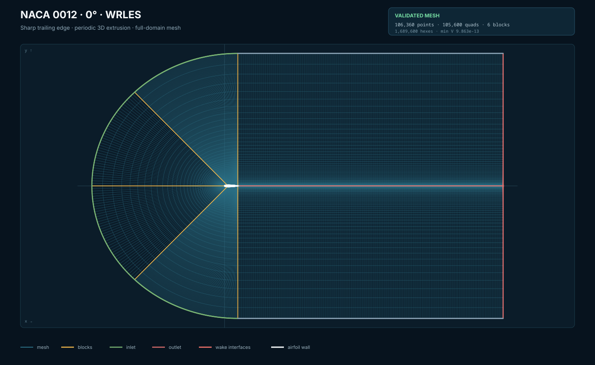
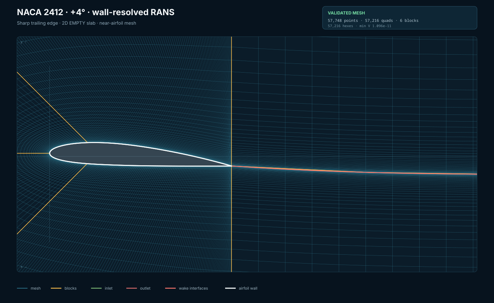
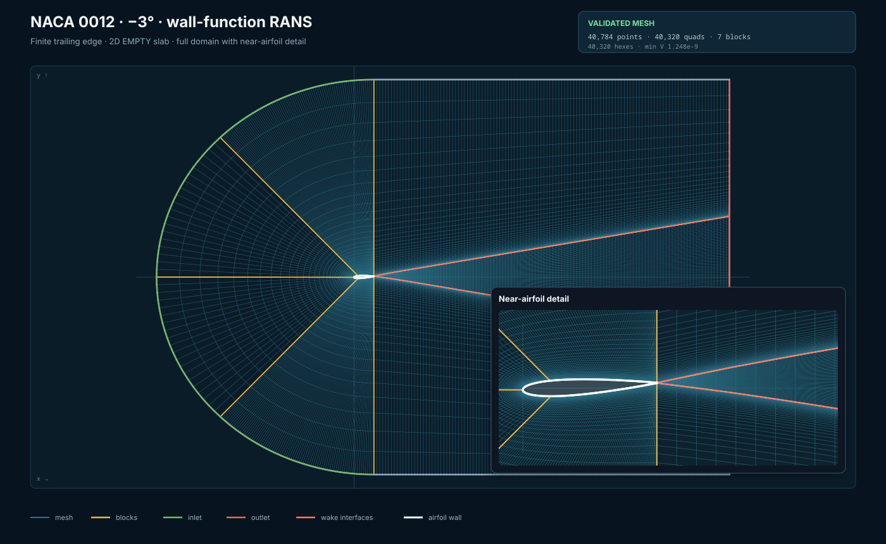
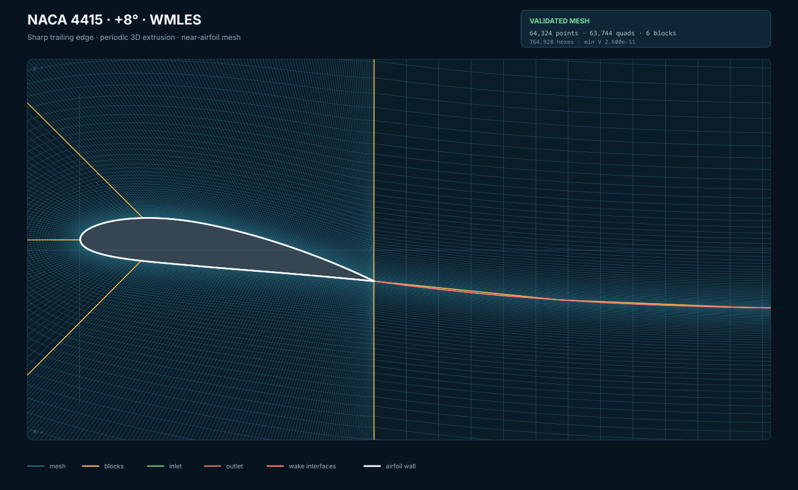

# afoil_gen

`afoil_gen` is a local-first structured C-mesh generator for NACA 4-digit airfoils. Its Rust engine creates deterministic RANS and LES mesh configurations and exports meshes for OpenFOAM, Gmsh, and ANSYS Fluent. A React/WebAssembly interface provides local configuration and mesh previews without uploading case data.

## Features

- Structured quadrilateral 2D and hexahedral 3D C-meshes
- Wall-resolved RANS, wall-function RANS, WMLES, and WRLES starting presets
- Inflation-layer, wake-alignment, cell-budget, and predicted wall-unit controls
- Mesh previews and geometric quality checks
- OpenFOAM `blockMeshDict`, Gmsh `.msh`, and Fluent `.msh` export

## Mesh examples

Each image is rendered from the generator's full mesh preview. These are mesh views, not CFD solution contours.

| Full-domain views | Near-airfoil views |
| --- | --- |
| [](examples/naca0012-les.json)<br>**NACA 0012 · 0° · WRLES**<br>Sharp trailing edge, periodic 3D extrusion | [](examples/naca2412-rans.json)<br>**NACA 2412 · +4° · wall-resolved RANS**<br>Sharp trailing edge, 2D-equivalent `EMPTY` slab |
| [](examples/naca0012-rans-finite.json)<br>**NACA 0012 · −3° · wall-function RANS**<br>Finite trailing edge, full domain with near-field inset | [](examples/naca4415-wmles.json)<br>**NACA 4415 · +8° · WMLES**<br>Sharp trailing edge, periodic 3D extrusion |

## Requirements

- Rust 1.88 or newer (the development and CI toolchain is pinned to 1.99)
- Node.js 22 or newer with npm
- `wasm-pack` 0.15

Install the WebAssembly build tools once:

```bash
rustup target add wasm32-unknown-unknown
cargo install wasm-pack --locked --version 0.15.0
```

## Run the web interface

```bash
git clone https://github.com/tokito-99/afoil_gen.git
cd afoil_gen
npm ci
npm run dev
```

Open the local URL printed by Vite. The first run builds the Rust engine to WebAssembly before starting the frontend.

## Use the CLI

Build the optimized command-line executable:

```bash
cargo build --release -p mesh-cli
```

Validate an example and generate its enabled outputs:

```bash
target/release/mesh-cli validate examples/naca2412-rans.json
target/release/mesh-cli generate examples/naca2412-rans.json \
  --output-dir examples/generated/naca2412-rans
```

Export an ANSYS Fluent mesh directly:

```bash
target/release/mesh-cli fluent examples/naca0012-student-wrles.json \
  --output examples/generated/naca0012-wrles.msh
```

Generated files are ignored by Git. Add `--force` when you intentionally want to replace an existing output.

See the [short tutorial](docs/tutorial.md) for RANS, LES, visualization, quality-audit, and solver-export examples. Run `target/release/mesh-cli --help` for every command.

## Verify changes

```bash
cargo fmt --all --check
cargo clippy --workspace --all-targets --all-features -- -D warnings
cargo test --workspace --all-targets --all-features
npm ci
npm run lint
npm run test
npm run build
```

## Scope

The tool generates and audits meshes. It does not solve the flow or certify RANS/LES accuracy. Always inspect the mesh in the target solver and perform appropriate grid, time-step, span, and statistical-convergence studies.

## Contributing and security

See [CONTRIBUTING.md](CONTRIBUTING.md) for contribution checks and [SECURITY.md](SECURITY.md) for private vulnerability reporting.

## Author

Created and maintained by Rishav Mishra.

## License

Licensed under either [MIT](LICENSE-MIT) or [Apache License 2.0](LICENSE-APACHE), at your option.
