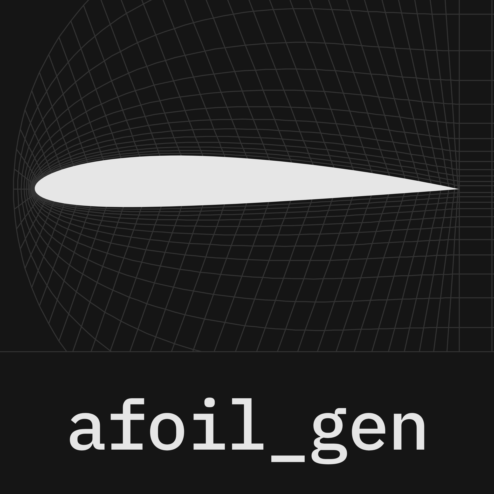
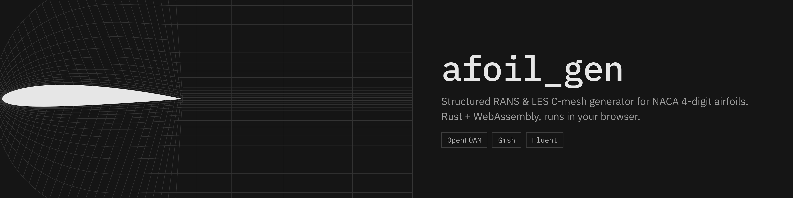

<p align="center">
  
</p>

<p align="center">
  
</p>

<p align="center">
  <a href="https://github.com/tokito-99/afoil_gen/actions/workflows/ci.yml"></a>
  <a href="rust-toolchain.toml"></a>
  <a href="crates/mesh-wasm"></a>
  <a href="#license"></a>
</p>

<p align="center">
  <strong>Structured C-mesh generation for NACA 4-digit airfoils.</strong><br />
  Rust CLI and React/WebAssembly workspace with RANS and LES starting configurations.
</p>

<p align="center">
  <a href="#quick-start">Quick start</a> ·
  <a href="#mesh-examples">Examples</a> ·
  <a href="docs/tutorial.md">Tutorial</a> ·
  <a href="CONTRIBUTING.md">Contributing</a>
</p>

`afoil_gen` generates deterministic structured airfoil C-grids locally. The Rust engine can run from the command line or in the browser through WebAssembly, without uploading case or mesh data to a server.

## Capabilities

| Area | Support |
| --- | --- |
| Geometry | NACA 4-digit profiles, angle of attack, sharp or finite trailing edge |
| Mesh | Structured 2D quadrilaterals and extruded 3D hexahedra |
| CFD intent | Wall-resolved RANS, wall-function RANS, WMLES, and WRLES starting presets |
| Resolution | Inflation layers, wake alignment, wall-unit targets, and bounded cell planning |
| Quality | Geometry validation, mesh-quality metrics, wall-resolution audits, and study preparation |
| Export | OpenFOAM `blockMeshDict`, Gmsh `.msh`, ANSYS Fluent `.msh`, and preview JSON |

## Quick start

### Browser workspace

Requirements: Rust 1.88 or newer, Node.js 22 or newer, and `wasm-pack` 0.15.

```bash
git clone https://github.com/tokito-99/afoil_gen.git
cd afoil_gen
rustup target add wasm32-unknown-unknown
cargo install wasm-pack --locked --version 0.15.0
npm ci
npm run dev
```

Open the local address printed by Vite. The first run builds the Rust engine to WebAssembly.

### Command line

```bash
cargo build --release -p mesh-cli

target/release/mesh-cli validate examples/naca2412-rans.json
target/release/mesh-cli generate examples/naca2412-rans.json \
  --output-dir examples/generated/naca2412-rans
```

Export an ANSYS Fluent mesh directly:

```bash
target/release/mesh-cli fluent examples/naca0012-student-wrles.json \
  --output examples/generated/naca0012-wrles.msh
```

Generated meshes are ignored by Git. Add `--force` when you intentionally want to replace an existing output.

## Mesh examples

These images come from the generator's full-mesh preview. They show mesh topology, not CFD solution contours. Select an image to open its configuration.

| Full-domain views | Near-airfoil views |
| --- | --- |
| [](examples/naca0012-les.json)<br>**NACA 0012 · 0° · WRLES**<br>Sharp trailing edge, periodic 3D extrusion | [](examples/naca2412-rans.json)<br>**NACA 2412 · +4° · wall-resolved RANS**<br>Sharp trailing edge, 2D-equivalent `EMPTY` slab |
| [](examples/naca0012-rans-finite.json)<br>**NACA 0012 · −3° · wall-function RANS**<br>Finite trailing edge, full domain with near-field inset | [](examples/naca4415-wmles.json)<br>**NACA 4415 · +8° · WMLES**<br>Sharp trailing edge, periodic 3D extrusion |

## Documentation

- [Tutorial](docs/tutorial.md): RANS, LES, visualization, cell budgets, solver feedback, and export
- [`mesh-cli --help`](crates/mesh-cli/src/main.rs): complete command reference
- [Contributing](CONTRIBUTING.md): development workflow and checks
- [Security](SECURITY.md): private vulnerability reporting

## Scope

> `afoil_gen` generates and audits meshes. It does not solve the flow or certify RANS or LES accuracy.

Always inspect the mesh in the target solver and perform appropriate grid, time-step, span, and statistical-convergence studies.

<details>
<summary><strong>Development checks</strong></summary>

```bash
cargo fmt --all --check
cargo clippy --workspace --all-targets --all-features -- -D warnings
cargo test --workspace --all-targets --all-features
npm ci
npm run lint
npm run test
npm run build
```

</details>

## Author

Created and maintained by [Rishav Mishra](https://github.com/tokito-99).

## License

Dual-licensed under the [MIT License](LICENSE-MIT) or [Apache License 2.0](LICENSE-APACHE). You may use either license.
